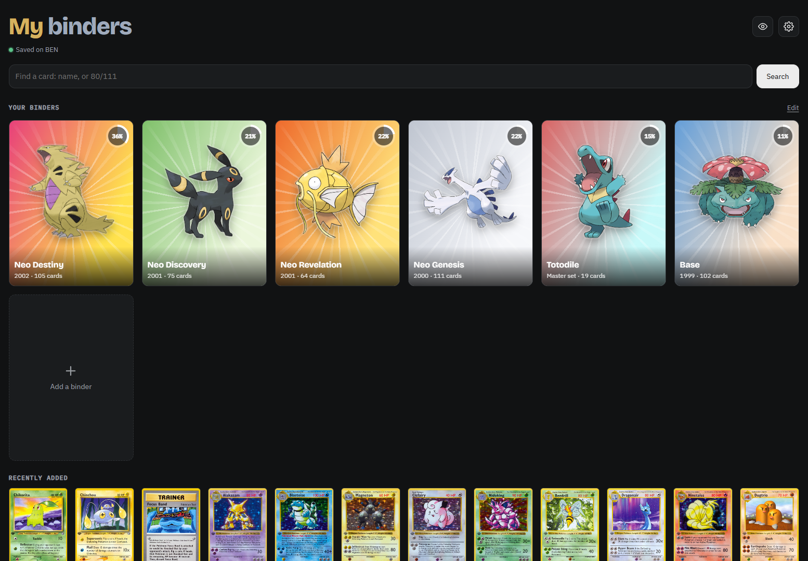
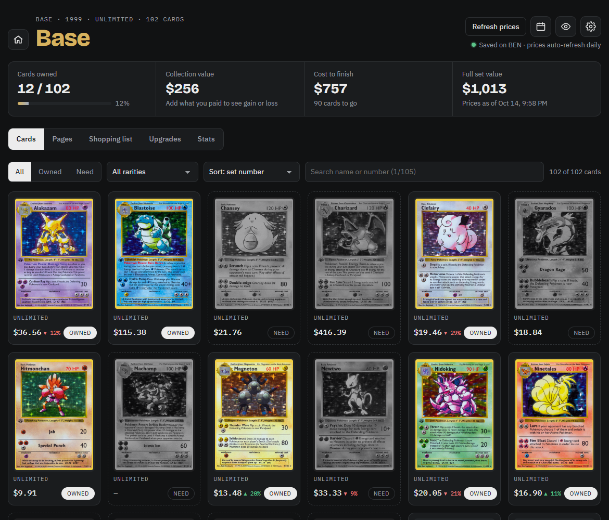
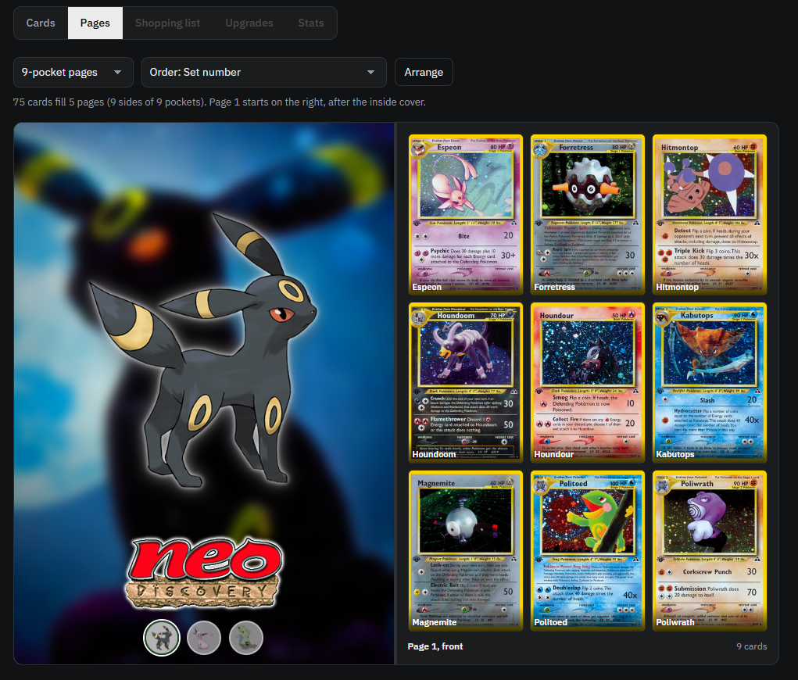
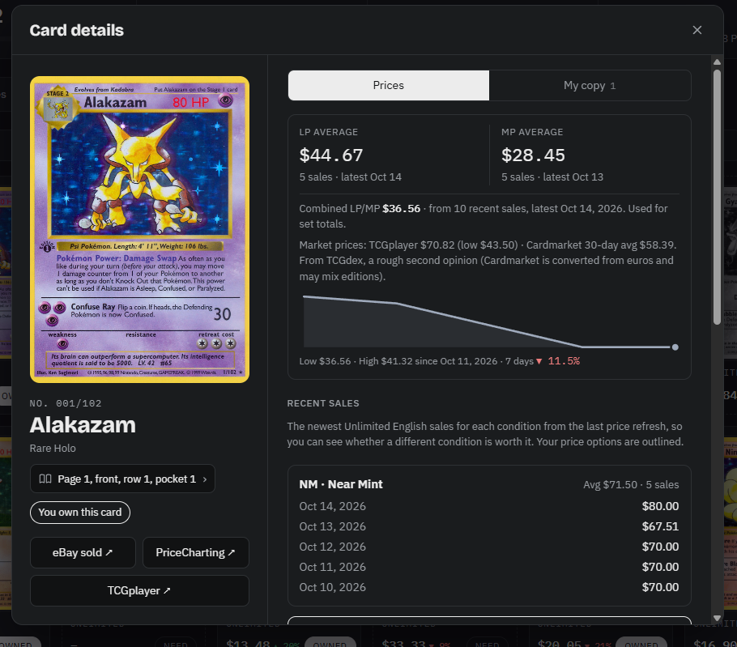
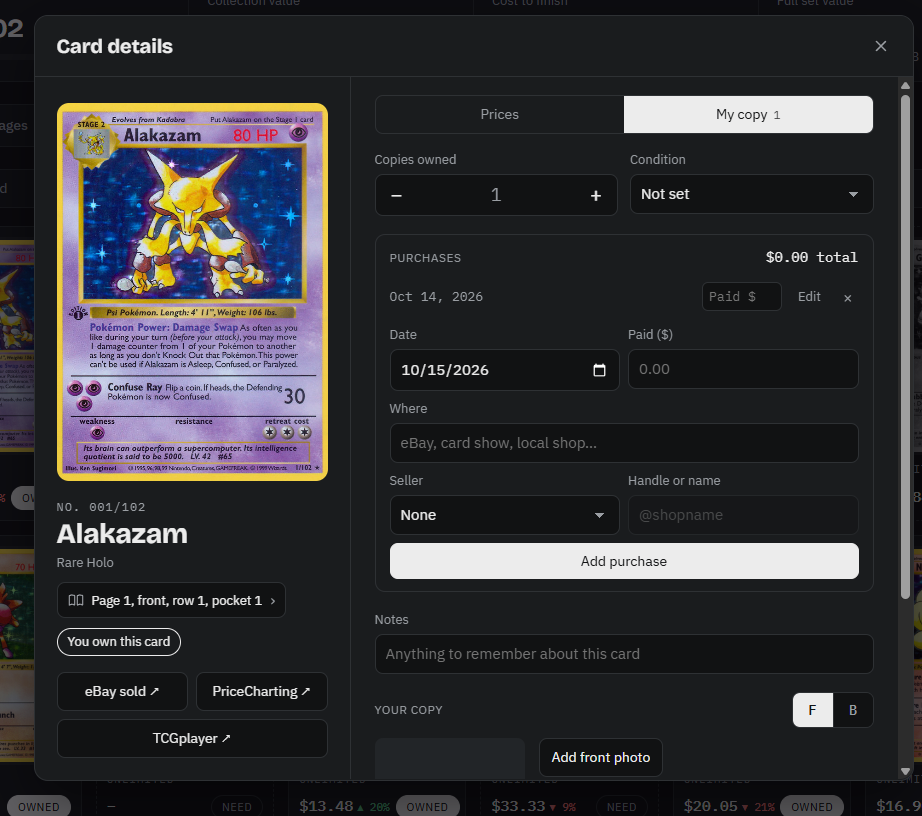
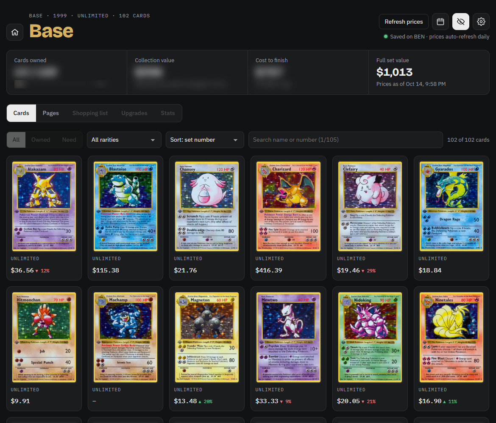
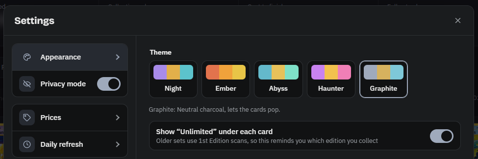

# Pokemon Binder

> [!WARNING]
> **This is a fully vibe-coded project.** I'm not a programmer. I had an idea for tracking my own card collection and built this with an AI assistant, for personal use on my home server. It works for me, but it hasn't been reviewed by an experienced developer, and it comes with no support or guarantees. Use it at your own risk, and don't expose it to the open internet.

A self-hosted Pokémon TCG collection tracker. One small Python server (standard library only) and one web page.

- Any English set: card lists from [PokemonTCG/pokemon-tcg-data](https://github.com/PokemonTCG/pokemon-tcg-data), card images downloaded locally
- Pokémon master set binders: every English card of one Pokémon (like all the Totodile cards) across every set, with its game sprite from [PokeAPI](https://github.com/PokeAPI/sprites)
- Your own binders, filled with cards from any set (like Favorites or Trade pile)
- Find a card: search every English card and set by name, number (like `80/111`) or set, see which binders have it, and add it to any binder
- Pages: lay out a binder like a real one (4, 9, 12 or 16 pockets), arrange cards by tapping or dragging, and see where each card goes
- Owned cards in color, needed cards in greyscale; tap **Need** to mark a card owned
- Search by name or by the number on the card (like `1/105`)
- Recent sales tab on each card: the last 5 sales for every condition, side by side
- Prices from recent sales, Unlimited English only: pick any two per binder in Settings, raw conditions (NM to Damaged, from TCGplayer) or graded (PSA, BGS, CGC, SGC, TAG, ACE, from eBay sales on PriceCharting). LP and MP by default.
- Custom cards for anything the card database is missing, priced from a TCGplayer link or a price you type
- Spreadsheet import and a template to fill in (Excel or CSV), and automatic backups on the server before every update and import
- Market prices as a backup and second opinion: TCGplayer's market price and Cardmarket's 30-day average (converted to US dollars) from [TCGdex](https://tcgdex.dev) (free, no key). Used when a card has no recent sales for your price options (can be turned off in Settings).
- Daily automatic price refresh at a time you choose, plus a manual refresh button
- Price history, biggest movers, shopping list with a budget and your own drag-to-reorder priority
- Upgrades list: worn copies you own and what a better one costs
- A home page with a shelf of your binders (cover Pokémon, completion that privacy mode hides), Find a card and recently added cards
- All-binders totals in the sets menu (Edit on the home page)
- Card shows: upcoming shows in your towns from [TreasureHunter.show](https://www.treasurehunter.show), checked weekly or on demand
- One-file backup and restore
- Purchase log with date, price, place, and seller handle (Instagram, TikTok, Whatnot, eBay, and more)
- Front and back photos of your own copies
- Privacy mode (eye button): shows every card in color with no Owned/Need tags, blurs cards owned and money totals, hides purchases
- Five dark themes and your own browser tab icon; works on phones

## Screenshots

**Home.** A shelf of all your binders, each with its cover Pokémon and how complete it is, plus Find a card and the cards you added most recently.



**The binder.** Owned cards in color, cards you still need in greyscale, with totals at the top and each card's price trend.



**Pages.** Lay out a binder like a real one, page by page, with an inside cover featuring one of the set's best cards. Tap the round buttons to pick which Pokémon is on the cover.



**Card details.** The card, its prices from recent sales, market prices, a price chart, and the newest sales for every condition, so you can see whether a different condition is worth it.



**Your copy.** Copies owned, condition, a purchase log with where you bought it and from whom, notes, and photos of your own card.



**Privacy mode.** Tap the eye button: every card shows in color, Owned/Need tags disappear, your totals blur, and the Shopping list, Upgrades and Stats tabs are locked, so nobody looking over your shoulder can tell what you own.



**Settings.** Themes, price options, the daily price check, backups, updates and more.



## How was this possible?

I don't know how to code. I built this by describing what I wanted to an AI assistant, testing each version, and asking for changes one at a time. If you'd like to build something similar for yourself, running on your own computer and opening on your phone, I wrote up how it works in beginner terms, including what Tailscale is and how to set it up.

**[Read: How I built this without knowing how to code](docs/how-this-was-made.md)** · [PDF version](docs/how-this-was-made.pdf)

Your collection, purchases, photos, and prices are stored only on the machine running the binder. This repository holds program files only.

## Program files

| File | What it is |
|---|---|
| `server.py` | The web server |
| `index.html` | The binder page |
| `fonts.css` | The page's fonts, built in so the binder doesn't ask Google for them (since v3.5) |
| `fonts-OFL.txt` | The fonts' free license (not installed on your server) |
| `seed_prices.json` | Starting Neo Destiny prices, only used on a brand-new install |
| `tests/smoke_test.py` | Checks the binder before a release: `python3 tests/smoke_test.py` (not installed on your server) |

## Your data (never in this repository)

Stored in `data/` next to `server.py`:

| Path | What it holds |
|---|---|
| `binder.db` | Everything you enter and every price: binders, settings, copies owned, condition, purchases, sellers, notes, latest prices, one saved price per card per day, price options, shopping lists, card shows. One SQLite database file (since v3.0) |
| `favicon` | Your tab icon, if you picked one |
| `catalog.json`, `dex_index.json`, `fx.json` | Downloaded lists (all English sets, the Pokédex index, the euro rate). They download again by themselves |
| `sets/<set id>/images/` | Card pictures: `s/` holds the small ones for the grid, full-size scans are saved when you open a card. Pictures download as you look at them; a binder kept for an hour fills in the rest in the background |
| `sets/<set id>/photos/` | Your photos (front = `<number>`, back = `<number>_back`) |
| `pre-sqlite-<date>/` | Your old JSON files from before v3.0, set aside (not used any more) |

Backups (Settings → Backup) are still a zip of plain JSON files, so they open in any text editor and restore in both older and newer versions. To look inside `binder.db` itself, use a viewer like DB Browser for SQLite.

## Running it with Docker (Unraid example)

| Setting | Value |
|---|---|
| Image | `python:3.12-alpine` |
| Port | any free port on the host → `8080` in the container |
| App data | a folder on the host → `/app` (put `server.py`, `index.html` and `fonts.css` in it) |
| Extra parameters | `-w /app` |
| Post arguments | `python -u server.py` |
| Variable (optional) | `BINDER_HOSTS`: extra names the binder answers to, like a reverse proxy name (IP addresses, one-word names and Tailscale names already work) |

Without Docker: put `server.py`, `index.html` and `fonts.css` in a folder and run `python server.py` (Python 3.9 or newer), then open `http://localhost:8080`.

## Phone app

The binder can be installed as an app on Android (Chrome). It needs a secure (https) address, which [Tailscale](https://tailscale.com/kb/1312/serve) can provide for free inside your own Tailscale network:

1. In the Tailscale admin console, under **DNS**, turn on **MagicDNS** and **HTTPS Certificates**.
2. On the computer running the binder, run `tailscale serve --bg 8765` (use your binder's port). Tailscale prints the https address, like `https://<machine>.<your-tailnet>.ts.net`.
3. On your phone (with Tailscale on), open that address in Chrome and tap **Install** (or Settings → Server → Phone app).

This keeps the binder inside your Tailscale network; nothing is opened to the internet.

The app keeps a saved copy of your binders on the phone, so it opens with no signal. Offline you can mark cards owned and add purchases (price, where, seller); when the connection is back, the binder lists those changes and sends them only after you tap **Sync**, with **Undo last sync** if needed.

## Updating

Updates only install when you choose them: **Settings → About → Check for updates** shows what's new and asks before installing anything (no restart needed). Restarting the container never installs updates. No key or password is needed.

Settings → About shows the installed version, any update problem, and up to 3 previous versions you can roll back to. Version history is in [CHANGELOG.md](CHANGELOG.md).

Safety nets:
- Before installing, the new version is test-started on its own with a copy of your data. If it has an error or doesn't start, nothing is installed and the current version keeps running.
- A backup of your data is saved first (Settings → Backup → Saved on the server). A daily backup is also saved every day and the last 7 are kept.
- The binder checks itself every 2 minutes and restarts if it stops answering for about 6 minutes. **Settings → About → Status** shows the last price check, last backup, storage used, free space and any problems in the last day. `/api/health` answers for outside uptime monitors.
- The last 3 versions are kept in `previous/` next to `server.py`. Rolling back to a version from before v3.0 writes your data back out as the files it uses.
- The files a version needs are listed in its `server.py` (`APP_FILES`), so versions can have more than two files.

Optional environment variables:

| Variable | Default | Use |
|---|---|---|
| `GITHUB_REPO` | `g-i-n-g-y/pokemon-binder` | Where updates come from. Set it empty to turn GitHub updates off. |
| `GITHUB_BRANCH` | `main` | Branch to update from |
| `GITHUB_TOKEN` | (none) | Only needed if you update from a private copy |
| `BINDER_UPDATES` | `/updates` | Folder used for updates when `GITHUB_REPO` is empty |

## Price test for one card

```bash
docker exec <container name> python server.py --test neo4-1
```

## Credits and inspiration

- **[Tracearr](https://github.com/connorgallopo/Tracearr)** by Connor Gallopo inspired several design ideas: the What's new window (versions grouped with Installed and Latest tags, opened from the version number), the update notice, and the sets menu that slides out and pushes the page over. I showed screenshots and a screen recording of Tracearr to Claude (the AI assistant this app is built with) as a reference, and it wrote this app's own versions of those features. None of Tracearr's code was used.
- Card lists and images: [PokemonTCG/pokemon-tcg-data](https://github.com/PokemonTCG/pokemon-tcg-data)
- Pokémon sprites: [PokeAPI/sprites](https://github.com/PokeAPI/sprites)
- Card show listings: [TreasureHunter.show](https://www.treasurehunter.show)
- Prices: TCGplayer recent sales and PriceCharting, plus market prices from [TCGdex](https://tcgdex.dev)

Pokémon and all related names and images are trademarks of Nintendo, Creatures and GAME FREAK. This is a personal, unofficial project.
