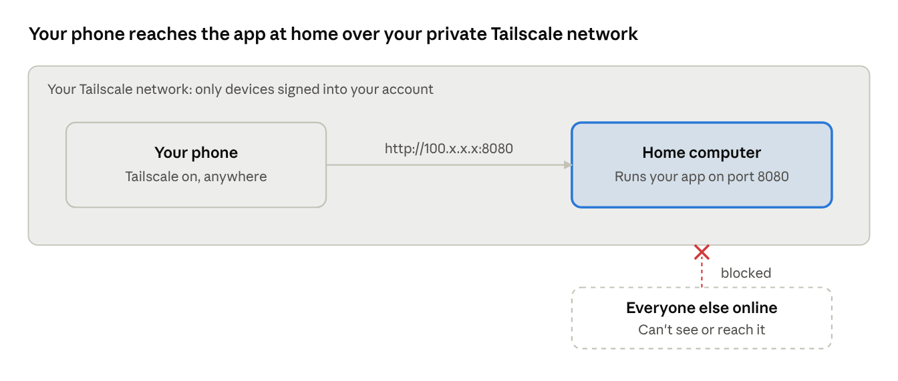

# How I Built My Pokémon Card Binder (Without Knowing How to Code)

October 2026 · [Download as PDF](how-this-was-made.pdf)

## The short version

I built a website that tracks my Pokémon card collection, runs on a computer in my house, and opens on my phone from anywhere. I can't write code. An AI assistant wrote all of it while I described what I wanted, tested it, and said what to change.

The binder shows every card in a set, which ones I own, what each is worth based on recent sales, and what I've spent. It started as a spreadsheet and grew one request at a time over about two days.

The skill that mattered wasn't programming. It was knowing what I wanted, trying each version, and explaining clearly what was wrong or missing.

## What you need

Four pieces. You probably own two of them already.

| Piece | What it does | What I used | Easiest choice for you |
| --- | --- | --- | --- |
| An AI assistant | Writes the code from your description and walks you through each step | Claude | Claude or ChatGPT. Free to try; a paid plan helps on bigger projects. |
| A computer that stays on | Runs your app around the clock so it's always there when you open it | A home server running Unraid | Any old laptop or desktop you can leave on, Windows or Mac |
| A way to run the app | The program that turns the AI's code into a working website | Python inside Docker (a container) | Python, installed for free from python.org. Skip Docker at first. |
| A private connection | Lets your phone reach the home computer from anywhere, without opening it to the internet | Tailscale | Tailscale, free for personal use |

Optional later: **GitHub**, a free site that stores your code and its history. Mine gets updates from GitHub when I tap a button and confirm, but you don't need it to start.

## Tailscale, in plain words

Tailscale makes your phone and your home computer act like they're on the same Wi-Fi, even when you're miles away. Only devices signed into your Tailscale account can see each other, so your app stays private.

Without it, your app only works at home. The usual alternative is opening your home network to the internet, which is risky and takes real know-how. Tailscale skips all of that.

Your phone and home computer talk directly over Tailscale; nobody outside your account can even see the app is there.

**Setting it up (about 10 minutes):**

1. Go to tailscale.com and sign up with a Google, Microsoft, or Apple account.
2. Install the Tailscale app on the home computer and sign in.
3. Install the Tailscale app on your phone and sign in with the same account.
4. In the app, find your home computer in the device list. It has a Tailscale address that starts with **100.**, like 100.101.102.103.
5. On your phone, with Tailscale switched on, open the browser and type that address plus your app's port, like **http://100.101.102.103:8080**.

Type the address with **http://** at the front. Some browsers otherwise try a secure connection the app doesn't have and show an error. The AI can explain the port number when it gets there.

## How to build your own

1. **Pick one small thing you'd actually use.** A collection tracker, a recipe list, a chore chart. Mine started as "show my cards and what they're worth."
2. **Tell the AI the whole picture up front.** What it's for, that you don't code, and that you want it to run on your own computer and open on your phone. Ask it to explain every step in beginner terms and to stop after each step so you can report back.
3. **Let it build the first version.** It will give you a few files and tell you where to put them and what to type to start the app.
4. **Open it and try everything.** Click every button. Note what's wrong, confusing, or missing.
5. **Ask for one change at a time.** "Make cards I don't own grey." "Add a button that marks a card as owned." Small requests are easier to check and easier to undo.
6. **Set up Tailscale** once it works at home, so it opens on your phone too.
7. **Keep going.** Every feature in my binder came from using it and thinking "it would be nice if..."

## What made it work

- **Send screenshots.** A picture of what's wrong beats a paragraph describing it. Error messages count too: copy and paste them exactly.
- **Report back after every step.** Say "done" or paste what the screen shows. The AI can't see your computer, so your report is its only way to know what happened.
- **Say what you want, not how to build it.** "I want to know how much I've spent each month" is enough. Working out the how is the AI's job.
- **Ask "why" whenever you're unsure.** Mine explained what each piece does, which is how I learned what Docker and Tailscale even are.
- **Back up before big changes.** Copy your app's data folder somewhere safe first. Ask the AI to keep your data in its own folder, apart from the code, so an update can never wipe it.
- **Never put passwords or keys in your code.** Especially if you share it online. Ask the AI to check for you before sharing.

## Words you'll run into

| Word | What it means |
| --- | --- |
| Server | A computer whose job is to stay on and serve something, like a website, to other devices. An old laptop works fine. |
| Self-hosted | Running an app on your own computer instead of a company's. |
| Python | A programming language. You install it once; it's what runs the code the AI writes. |
| Terminal | The text window where you type commands. The AI tells you exactly what to type. |
| IP address | A device's address on a network, like 192.168.1.20 at home or 100.x.x.x on Tailscale. |
| Port | A numbered door on a computer. One computer can run several apps, each on its own port, like 8080. |
| localhost | "This computer." Opening http://localhost:8080 means "the app on port 8080 on the computer I'm sitting at." |
| Docker / container | A tidy box that holds an app and everything it needs. Handy on servers, but optional when you're starting out. |
| GitHub | A free website that stores code and every past version of it. Useful for backups and updates. |
| Vibe coding | Building software by describing what you want to an AI instead of writing the code yourself. |
